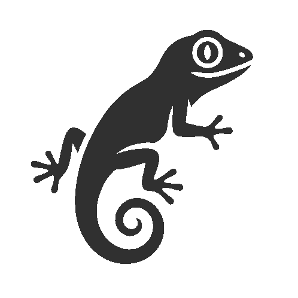
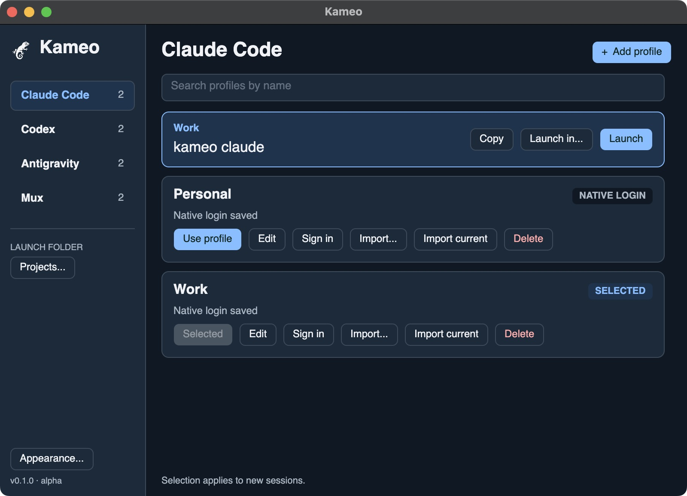
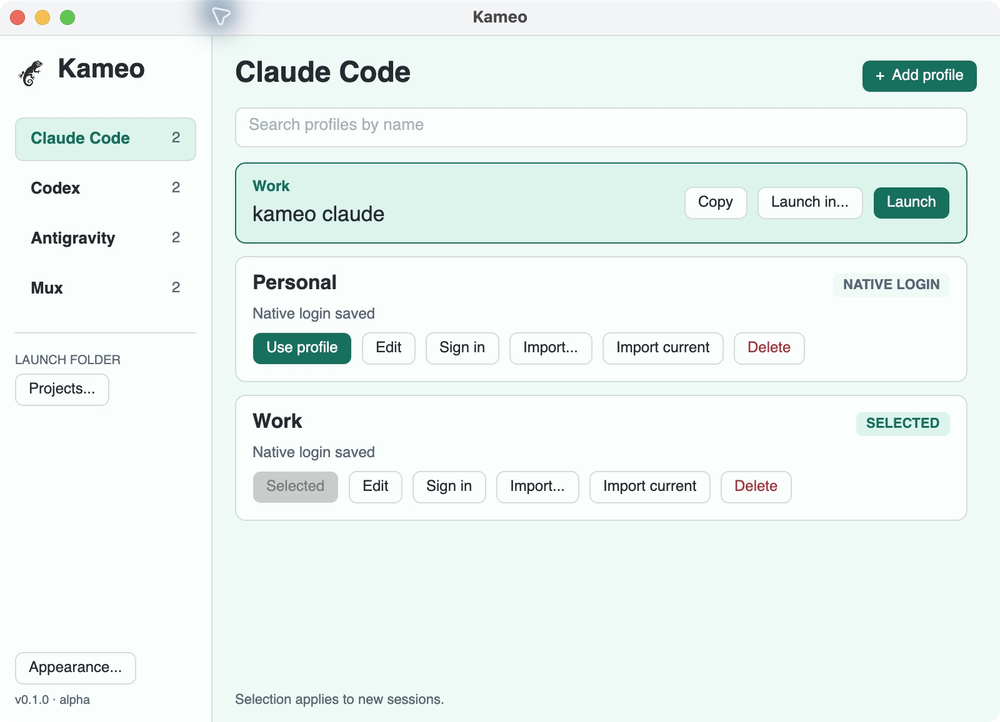
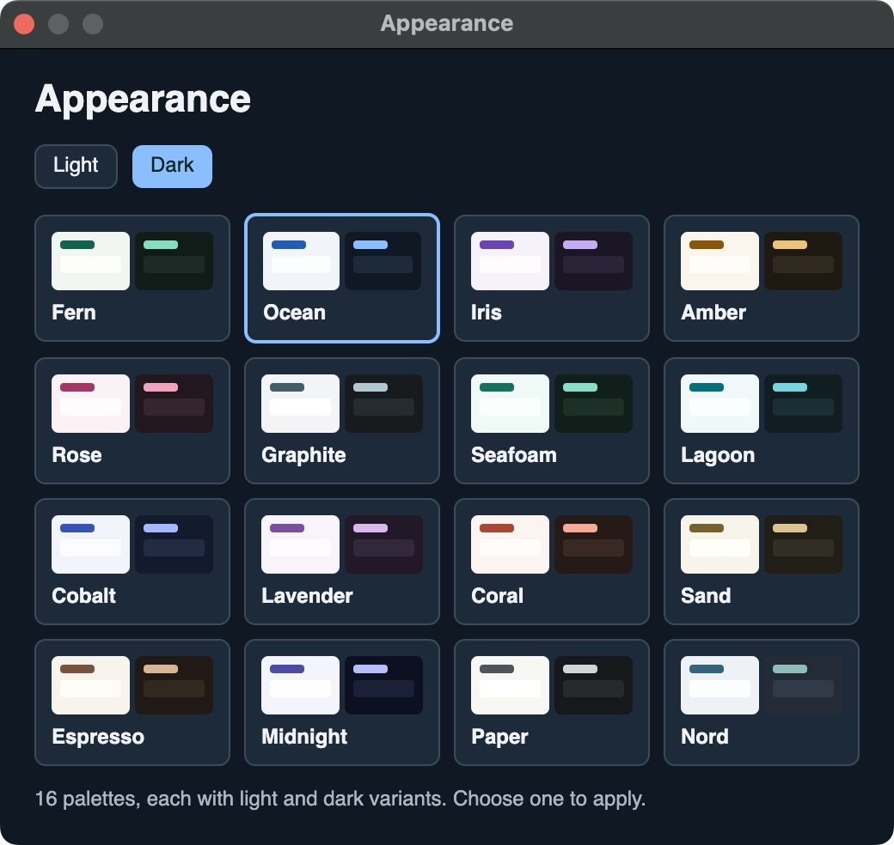
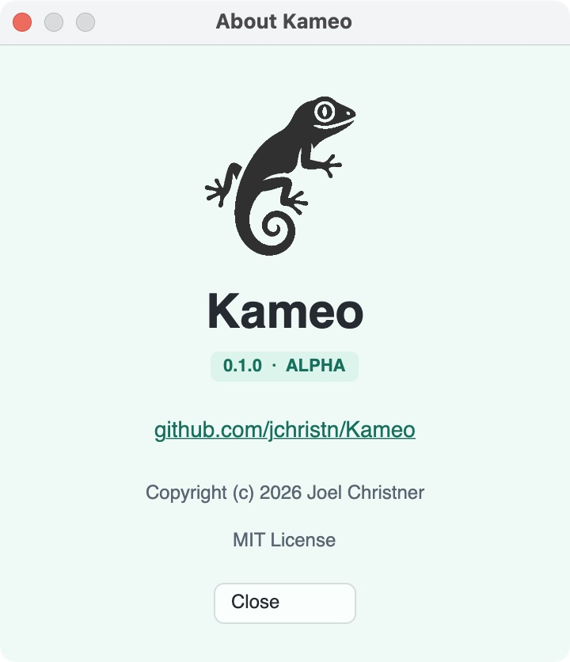

<p align="center"></p>

<p align="center"><strong>v0.1.0 · Alpha</strong></p>

# Kameo

Kameo is a small desktop and tray application for switching agent credentials. Keep work, personal, and client identities in separate profiles, choose one, and launch your agent through Kameo. New sessions use the selected profile; existing sessions keep theirs.

Built with C#, .NET 10, and Avalonia for Windows, macOS, Linux, WSL, and WSL2. Includes a terminal CLI that works without the desktop running. MIT licensed. Clone and build from source; there are no installers.

## Features

- Add, rename, edit, import, select, and delete credential profiles.
- API keys for all supported harnesses; isolated native subscription/OAuth logins for Claude Code, Codex, and Antigravity, and endpoint-file profiles for Mux.
- Import existing native credential files without modifying the originals.
- Independent selections for Claude Code, Codex, Antigravity, and Mux.
- Shared Mux endpoints files: choose one JSON file for multiple profiles and pick up source changes at the next launch.
- Tray selection, search, launch-folder selection, and a compact desktop manager.
- 16 palettes with coordinated light and dark backgrounds, panels, and accents: Fern, Ocean, Iris, Amber, Rose, Graphite, Seafoam, Lagoon, Cobalt, Lavender, Coral, Sand, Espresso, Midnight, Paper, and Nord.
- Native macOS application menus, including About, Edit, Profiles, View, Window, and Quit. Profiles submenus launch the selected account in your saved folder or a folder chosen for that session.
- Palette-aware About and two-second startup splash screens with the project logo and GitHub link. Background tray startup stays unobtrusive.
- Plaintext local storage under `~/.kameo/`, with owner-only Unix permissions.
- No account, hosted service, or credential synchronization required.

## Screenshots

Captured on macOS with sample profiles. Click an image to view it at full size.

| Profile manager · Ocean dark | Profile manager · Seafoam light |
| --- | --- |
| [](docs/screenshots/profiles-dark.jpg) | [](docs/screenshots/profiles-light.jpg) |

| Appearance · 16 palettes in light and dark | About · also used for the startup splash |
| --- | --- |
| [](docs/screenshots/appearance.jpg) | [](docs/screenshots/about.jpg) |

## Getting started

### Install from source

Install Git, the [.NET 10 SDK](https://dotnet.microsoft.com/download/dotnet/10.0), and whichever harnesses you want to use. Kameo does not install the harnesses. Their commands must be on `PATH`, or you can set an executable path in each profile.

Clone the repository and enter its directory:

```sh
git clone https://github.com/jchristn/Kameo.git
cd Kameo
```

Build and start using the scripts for your platform. Run Windows commands from Command Prompt, or prefix them with `.\` in PowerShell:

| Platform | Build | Start |
| --- | --- | --- |
| Windows | `scripts\windows\update.bat` | `scripts\windows\start.bat` |
| macOS | `./scripts/macos/update.sh` | `./scripts/macos/start.sh` |
| Linux | `./scripts/linux/update.sh` | `./scripts/linux/start.sh` |
| WSL | `./scripts/wsl/update.sh` | `./scripts/wsl/start.sh` |
| WSL2 | `./scripts/wsl2/update.sh` | `./scripts/wsl2/start.sh` |

The build writes the CLI to `artifacts/cli/` and the desktop to `artifacts/desktop/`. On macOS it also creates the locally ad-hoc-signed `artifacts/Kameo.app`, which can be opened in Finder. This is a local build output, not an installer. Builds use your machine's architecture and require the .NET 10 runtime to remain installed.

Linux needs a graphical desktop with X11 or an appropriate compatibility layer, fontconfig, and a terminal such as `xterm`, `gnome-terminal`, or `konsole`. Tray support depends on the desktop's StatusNotifier/AppIndicator support. The manager remains available without a tray host; closing its window on Linux exits Kameo. On Windows and macOS, closing the manager keeps Kameo in the tray. Quit from the tray or native application menu.

Once Kameo opens, [add your first profile](#add-your-first-profile), select it, and launch your harness. To enable automatic startup, run `scripts\windows\run-at-startup.bat` on Windows or `./scripts/<platform>/run-at-startup.sh` on macOS, Linux, WSL, or WSL2, replacing `<platform>` with the directory name from the table. This is optional and applies only to your user account.

### Windows and WSL

Install Kameo in Windows **or inside a WSL distribution**, using the corresponding SDK, harness executables, and scripts. Each installation uses its own home directory and profiles. Kameo does not bridge Windows credentials into WSL.

WSL2 can use WSLg or an external X server. WSL1 needs an external X server. WSLg alone does not provide a conventional desktop tray, so use the manager window. The CLI works in headless WSL. WSL startup registration adds a marked block to `.bashrc` and `.zshrc`; it starts the app from an interactive shell only when a graphical display is available.

### Remove Kameo by OS

Close agent sessions launched through Kameo before removing it. If you want to erase saved credentials as well, delete the profiles in Kameo **before** stopping the app. On macOS, this also removes each Claude profile's scoped Keychain entry; deleting the data folder alone does not remove those entries.

From the clone's root directory, run the following commands in order. Run Windows commands in Command Prompt, or prefix them with `.\` in PowerShell. If you use a custom data directory, set `KAMEO_HOME` to that directory in this shell before running the commands so the stop script targets the correct desktop instance. Keep the clone and .NET runtime available until these steps finish.

| Platform | 1. Remove automatic startup | 2. Stop the desktop |
| --- | --- | --- |
| Windows | `scripts\windows\remove-from-startup.bat` | `scripts\windows\stop.bat` |
| macOS | `./scripts/macos/remove-from-startup.sh` | `./scripts/macos/stop.sh` |
| Linux | `./scripts/linux/remove-from-startup.sh` | `./scripts/linux/stop.sh` |
| WSL | `./scripts/wsl/remove-from-startup.sh` | `./scripts/wsl/stop.sh` |
| WSL2 | `./scripts/wsl2/remove-from-startup.sh` | `./scripts/wsl2/stop.sh` |

The startup-removal script removes Kameo's Windows Startup entry, macOS LaunchAgent file, Linux autostart entry, or WSL shell hooks. It is safe to run even if automatic startup was never enabled.

After both commands succeed:

| Platform | Remove the application | Optional: erase remaining local data |
| --- | --- | --- |
| Windows | Delete the cloned `Kameo` folder in File Explorer, including `artifacts`. | Delete `%USERPROFILE%\.kameo`. |
| macOS | Move the cloned `Kameo` folder to Trash in Finder, including `artifacts/Kameo.app`. Remove any copies of `Kameo.app` you made elsewhere. | Use Finder's **Go → Go to Folder** to open `~/.kameo`, then remove that folder. |
| Linux | Delete the cloned `Kameo` folder with your file manager or from its parent directory in a terminal. | Delete `~/.kameo` in your Linux home directory. |
| WSL | Delete the clone inside the WSL distribution where you installed it. | Delete `~/.kameo` inside that distribution. |
| WSL2 | Delete the clone inside the WSL2 distribution where you installed it. | Delete `~/.kameo` inside that distribution. |

Keep the data folder if you want to retain profiles and preferences for a later reinstall. Removing it deletes Kameo's saved credentials, preferences, and profile-specific harness state. If you set `KAMEO_HOME`, use that custom directory instead of the default above. Windows and WSL installations are independent; repeat removal in each environment you used.

If you installed the CLI as a .NET global tool, also run `dotnet tool uninstall --global Kameo.Cli` in each Windows/WSL/macOS/Linux environment where you installed it. This leaves your profiles intact.

Remove any Kameo `PATH` entries, aliases, shortcuts, or symlinks you added manually. The removal steps leave your separately installed harnesses and their original credentials in place. Keep Git and .NET if other applications use them.

## Add your first profile

1. Select a harness and click **Add profile**.
2. Choose **API key** or **Native login / import**. For Antigravity, choose **Google account** or **API key**. For Mux, choose **API key** and enter the adapter, endpoint, and model, or choose **Endpoints file / setup** and browse to an existing endpoints JSON file.
3. For native authentication, click **Sign in** to open the harness in a terminal, **Import current** to copy an existing login, or **Import...** to select a native credential JSON file. Mux's **Setup** opens its interactive TUI and first-run wizard; an existing Mux profile can use its F1 setup command.
4. Click **Use profile** or choose the profile from the tray. The first profile for a harness is selected automatically.
5. Click **Launch** to use the saved launch folder, **Launch in...** to choose a folder for this session only, or use a Kameo terminal command. Canceling the folder picker starts nothing; choosing a folder with **Launch in...** does not change the saved launch folder in the sidebar.

The executable field accepts an executable name, absolute native executable path, or JavaScript entry point. On Windows, standard npm `.cmd` shims are resolved to their JavaScript entry points and launched with Node.js. Arbitrary batch files are rejected, so harness arguments never pass through `cmd.exe` inside Kameo.

## Launch from a terminal

The platform's `update` script in [Getting started](#getting-started) builds both the GUI and the CLI. It creates `artifacts/cli/kameo` on macOS, Linux, WSL, and WSL2, or `artifacts\cli\kameo.exe` on Windows. The `start` script also builds them if they are missing. **These scripts do not install a global tool or add `kameo` to `PATH`.** You can [install the CLI as a global tool](#build-and-install-as-a-net-global-tool) or use the source-build wrapper below.

### Build and install as a .NET global tool

With the .NET 10 SDK installed, run these commands from the clone's root. They work in Windows PowerShell, Command Prompt, macOS, Linux, WSL, and WSL2:

```sh
dotnet pack src/Kameo.Cli/Kameo.Cli.csproj -c Release -o artifacts/packages
dotnet tool install --global Kameo.Cli --version 0.1.0 --source ./artifacts/packages
kameo --version
```

`dotnet pack` builds the CLI and creates `artifacts/packages/Kameo.Cli.0.1.0.nupkg`. The install command uses that local package; no NuGet publication is needed. The package name is **Kameo.Cli**, and the installed command is **kameo**. Global means available to your current user from any directory. It installs the CLI only; build and start the desktop with the platform scripts above. Keep the .NET 10 runtime installed.

The .NET SDK normally adds its global-tools directory to `PATH`. If `kameo` is not found, reopen your terminal or add it for the current session:

```sh
# macOS, Linux, WSL, or WSL2 (bash/zsh)
export PATH="$HOME/.dotnet/tools:$PATH"
kameo --version
```

```powershell
# Windows PowerShell
$env:Path = (Join-Path $env:USERPROFILE '.dotnet\tools') + ';' + $env:Path
kameo --version
```

For future terminals, add `~/.dotnet/tools` to your shell's `PATH`, or `%USERPROFILE%\.dotnet\tools` to your Windows user **Path**. Install separately inside each WSL distribution. Remove an older Kameo alias or `artifacts/cli` PATH entry if it takes precedence over the global command; check with `command -v kameo` on bash/zsh or `Get-Command kameo` in PowerShell.

You can now change to any project directory and run `kameo list`, `kameo codex`, or another harness command. The global CLI uses the same `~/.kameo/` profiles as the desktop, or the directory selected by `KAMEO_HOME`. It runs independently of the clone after installation.

To install a rebuilt copy, run the following from the clone's root. During the alpha, builds retain version `0.1.0`, so uninstall and reinstall to replace that version rather than relying on a version-based update:

```sh
dotnet pack src/Kameo.Cli/Kameo.Cli.csproj -c Release -o artifacts/packages
dotnet tool uninstall --global Kameo.Cli
dotnet tool install --global Kameo.Cli --version 0.1.0 --source ./artifacts/packages --no-http-cache
```

The platform `update` scripts rebuild the source outputs; they do not replace an installed global tool. To remove just the global command, run `dotnet tool uninstall --global Kameo.Cli`. Your profiles and credentials remain intact. See Microsoft's [.NET tools guide](https://learn.microsoft.com/en-us/dotnet/core/tools/global-tools) for global-tool installation details.

### Use the source-build wrapper or PATH

After building, you can use the CLI immediately from the clone's root without changing `PATH`:

```sh
# macOS, Linux, WSL, or WSL2
./scripts/common/kameo.sh --version
./scripts/common/kameo.sh codex
```

```powershell
# Windows PowerShell (omit .\ in Command Prompt)
.\scripts\common\kameo.bat --version
.\scripts\common\kameo.bat codex
```

To use the shorter `kameo` command from any working directory, add the clone's **absolute** `artifacts/cli` directory to `PATH`. For the current terminal session, run the appropriate command below from the clone's root:

```sh
# macOS, Linux, WSL, or WSL2 (bash/zsh)
export PATH="$PWD/artifacts/cli:$PATH"
kameo --version
```

```powershell
# Windows PowerShell
$env:Path = (Join-Path (Get-Location).Path 'artifacts\cli') + ';' + $env:Path
kameo --version
```

For future terminals, add the absolute directory to your shell's `PATH` configuration (for example, `~/.zshrc` or `~/.bashrc`), or to your user **Path** in Windows Environment Variables, then open a new terminal. Configure it separately inside each WSL distribution. Keep the clone at that location; update the entry if you move it.

### Launch a harness

The examples below assume the global tool is installed or `PATH` is configured. Otherwise, replace `kameo` with the wrapper's path above or the absolute path to the built CLI.

```sh
kameo claude
kameo codex
kameo antigravity
kameo mux
kameo run codex -- --help
```

These are Kameo commands; the original `claude`, `codex`, `agy`, and `mux` commands keep their existing behavior. `kameo antigravity` launches Antigravity's `agy` executable. Wrappers preserve the current working directory, argument boundaries, and harness exit code. Desktop **Launch** uses the saved launch folder; **Launch in...** uses the folder chosen for that invocation.

```sh
kameo list
kameo add codex "Work" --native
kameo login prf_REPLACE_WITH_ID
kameo login prf_REPLACE_WITH_ID -- --device-auth
kameo import-current prf_REPLACE_WITH_ID
kameo import prf_REPLACE_WITH_ID /path/to/auth.json
kameo select prf_REPLACE_WITH_ID
kameo edit prf_REPLACE_WITH_ID --name "Work account"
kameo run-profile prf_REPLACE_WITH_ID -- --help
kameo delete prf_REPLACE_WITH_ID
```

`--device-auth` is a Codex option. Native-login completion is handled by the harness, including opening its browser and accepting any required login code. A saved credential indicator means a file exists; it does not claim that remote access has been validated.

API keys are entered in the desktop or supplied through standard input, never as CLI arguments. For example, if you already have a key in your environment:

```sh
printf '%s' "$OPENAI_API_KEY" | kameo add codex "API work" --api-key-stdin
```

Mux API-key profiles also need an endpoint configuration:

```sh
kameo mux-config prf_REPLACE_WITH_ID openai-compatible https://provider.example/v1 your-model
```

The desktop provides the same fields. Mux's current source has no separate subscription/OAuth login command. Its native profiles import `endpoints.json` or run Mux's setup UI, preserving the authentication supported by its adapters. API-key and header environment references in imported endpoints are captured at import time, so changing accounts in your shell cannot silently change the imported profile. Set referenced variables before importing.

Run `kameo --help` for the full command list. `KAMEO_HOME` or `kameo --home /absolute/path ...` selects an alternate data directory.

### Antigravity Google accounts and API keys

Install [Antigravity CLI](https://antigravity.google/docs/install?tab=cli) separately. **Google account profiles require CLI 1.5.7**; check `agy --version`. Kameo checks this version before each account session because account isolation relies on internal CLI behavior. Other versions are rejected until their behavior is verified and supported by Kameo.

1. Add an **Antigravity → Google account** profile, give it a name, and save.
2. Click **Sign in**. Follow the URL in the terminal, choose the Google account, and paste the returned authorization code into **that terminal**. The code is not an API key and does not belong in Kameo's API-key field.
3. Repeat with another profile for each account. Select a profile and click **Launch** or **Launch in...**, or run `kameo antigravity` to use the selected profile.

Each profile keeps its own renewable login file. Separate profiles can run concurrently, and token refresh stays with the profile that started the session. Kameo disables Antigravity's automatic updater for managed account sessions so it cannot silently change the verified storage behavior. Updating the CLI separately may require a compatible Kameo update. Managed account sessions use Antigravity's SSH-style file storage; child tools inherit the SSH-session indicator. The original `agy` command retains its normal behavior.

From the terminal:

```sh
kameo add antigravity "Work Google account" --native
kameo login PROFILE_ID
kameo select PROFILE_ID
kameo antigravity
```

Replace `PROFILE_ID` with the ID printed by `add`. Sign-in and refresh are handled by Antigravity itself. Kameo does not exchange authorization codes or export logins from the shared OS keyring. **Import** accepts an existing Antigravity account token file; **Import current login** works only when the default CLI already has a file-backed login. Otherwise, use **Sign in**.

API keys remain available: create an **Antigravity → API key** profile with a key from [Google AI Studio](https://aistudio.google.com/apikey). Kameo configures API-key authentication and passes the selected key to the child process. The account-specific version check does not apply to API-key profiles.

Existing profiles, keys, selections, and legacy login files are retained. An older Google native-login profile can now use **Sign in** to create an Antigravity login; its old login file is left intact and is not reused. Clear or update an older executable override to point to the supported `agy` binary. `kameo agy` is an alias for `kameo antigravity`. See the [integration notes](docs/ARCHITECTURE.md#antigravity) for storage details and verification limits.

### Share a Mux endpoints file

1. Select **Mux** and add a profile with **Endpoints file / setup**, or edit an existing Mux file profile.
2. Under **Shared endpoints file**, click **Browse endpoints...**. The picker starts in `~/.mux` for a new link; select any of your endpoints JSON files.
3. Save. Repeat for other profiles and choose the same file when you want them to share endpoints.

Kameo stores the source path and reads it again before each launch, placing a fresh copy in that profile's isolated Mux directory. Edits to the shared file apply to future launches. Running sessions keep their existing configuration. Kameo never edits or deletes the source, including when you delete a profile. Missing or invalid source files stop the launch rather than silently using an old copy. Environment references in shared endpoints are resolved from Kameo's environment at launch time; the referenced variables must be available there.

To stop sharing, clear **Shared endpoints file** and save; the most recent local copy remains available for this profile's Setup or import actions. For an independent copy from the outset, leave the shared file field blank and use **Import...** after saving. API-key profiles use their own key/endpoint fields; create an endpoints-file profile to use a file's existing credentials.

The CLI supports the same link:

```sh
kameo add mux "Shared work" --native --endpoints-file "$HOME/.mux/work-endpoints.json"
kameo edit prf_REPLACE_WITH_ID --endpoints-file /absolute/path/to/endpoints.json
```

## Authentication isolation

| Harness | Profile isolation | Native artifact |
| --- | --- | --- |
| Claude Code | `CLAUDE_CONFIG_DIR` | `.credentials.json`; scoped Keychain bridge on macOS |
| Codex | `CODEX_HOME`, file credential storage | `auth.json` |
| Antigravity | Isolated account token file and settings, or selected API key supplied to `agy` | Google accounts require CLI 1.5.7; legacy login files are preserved |
| Mux | `MUX_CONFIG_DIR` | `endpoints.json`, imported or refreshed from a shared source |

Kameo keeps a stable native directory for each profile, allowing the harness to refresh its own tokens and retain its profile-specific state. It does not copy refreshed tokens back into the original imported login. On macOS, Claude's directory-scoped Keychain entry is restored from the profile's file before launch and snapshotted after exit. Deleting that profile also removes its scoped Keychain entry, leaving the default login alone.

Existing supported file-based logins and Claude's macOS Keychain login can be imported automatically. For Codex logins stored only in an OS credential store, use **Sign in** to create an isolated login or import an exported native credential file. Antigravity imports accept its account token file; shared OS-keyring logins require a separate sign-in. Provider credential formats may evolve; the [integration notes](docs/ARCHITECTURE.md) record the contracts used here.

One running Kameo invocation holds an exclusive lease on its profile. Another invocation of that same profile, editing, import, or deletion waits for you to close it first; Kameo reports that the profile is in use. Other profiles can run concurrently, and you can change the selection at any time. This avoids concurrent native token refresh and destructive edits during a session.

Kameo removes inherited harness authentication overrides from the child environment. It rejects explicit arguments that replace the profile directory or credential storage mode. Project-local harness settings, administrator policies, and harness commands can still affect authentication: Kameo is a credential launcher, not an execution sandbox.

## Local data

```text
~/.kameo/
  kameo.db              # Structured profiles, API keys, selections, preferences
  profiles/prf_.../     # Native auth and harness-owned state, one directory per profile
  locks/               # Profile leases
  desktop.lock         # Single desktop instance per store
  launchers/           # macOS terminal launch scripts; contain no credentials
```

Kameo does not encrypt credentials at rest. Unix directories use `0700` and files written by Kameo use `0600`; Windows uses the home directory's inherited access controls. Use a private local filesystem. Backups contain credentials. Deleting a selected profile leaves the harness unselected instead of silently choosing another account. Files owned and created by the harness follow that harness's storage behavior.

## Lifecycle scripts

Every platform directory contains `start`, `stop`, `update`, `run-at-startup`, and `remove-from-startup`, with `.bat` on Windows and `.sh` elsewhere.

- **start** builds if needed, then opens Kameo. A second start opens the existing manager.
- **stop** gracefully stops only this Kameo desktop, preserving independently running agent sessions.
- **update** rebuilds the current source and restarts the desktop if it was running. It does not pull Git changes; run `git pull` separately when wanted.
- **run-at-startup** registers the source-built app for the next login: Windows Startup, a macOS LaunchAgent, Linux XDG autostart, or a WSL shell hook.
- **remove-from-startup** removes only Kameo's entry or marked shell blocks.

Startup entries point to this clone's build output. Re-register them if you move the clone. Scripts do not require administrator privileges. Startup registration does not sign in to any harness.

## Troubleshooting and issues

- **A harness cannot be found:** install it in the same Windows, macOS, Linux, or WSL environment as Kameo. Set its executable path in the profile if a desktop launch does not inherit your shell's `PATH`.
- **The wrong account appears:** launch with `kameo claude`, `kameo codex`, `kameo antigravity`, or `kameo mux`. Running the original harness command directly does not use Kameo's selection. Existing sessions keep the identity they started with.
- **A profile is in use:** close the agent session using that profile before editing, importing, deleting, or launching it again.
- **There is no tray icon on Linux or WSL:** use the manager window; tray availability depends on the desktop environment.
- **A native login has expired:** select the profile and use **Sign in**, or import its updated native credential file.

To report a bug or request a feature, [search existing issues](https://github.com/jchristn/Kameo/issues) first, then [open an issue](https://github.com/jchristn/Kameo/issues/new). Include:

1. Kameo version (`kameo --version`) and, for a source build, the commit (`git rev-parse --short HEAD`).
2. Operating system, architecture, .NET SDK version (`dotnet --version`), and whether you are using WSL or WSL2.
3. Harness name and version, reproduction steps, expected behavior, and actual behavior.
4. Relevant error messages or screenshots with credentials and personal information removed.

Do not attach `~/.kameo/`, its database, native credential files, API keys, or OAuth tokens. For a feature request, describe the workflow you want to support. This alpha may have rough edges; report reproducible problems so they can be investigated.

## Tests

```sh
dotnet build
mkdir -p artifacts/reports
dotnet run --project src/Test.Automated -- --results artifacts/reports/core.json --html artifacts/reports/core.html
dotnet test src/Test.Xunit3
dotnet test src/Test.Nunit
dotnet run --project src/Test.Desktop -- --results artifacts/reports/desktop.json
```

On Windows, use `New-Item -ItemType Directory -Force artifacts/reports` in PowerShell. All tests use disposable stores and synthetic credentials. No test signs in to a real provider or consumes API credits.

Touchstone descriptors in `Test.Shared` run through the console, xUnit v3, NUnit, and native AOT. Desktop tests exercise actual Avalonia control trees, and a separate native smoke test catches startup, tray-menu refresh, and shutdown failures. GitHub Actions runs the full suite on Linux, Windows, and macOS for every push and pull request. See [TESTING.md](TESTING.md).

## AOT support

`Kameo.Core` and `Kameo.Cli` are AOT compatible. `Test.Aot` runs every shared core suite without exclusions as a native binary. For example, on Apple Silicon:

```sh
dotnet publish src/Test.Aot -c Release -r osx-arm64 -o artifacts/aot
./artifacts/aot/Test.Aot --results artifacts/reports/aot.json
```

Use `linux-x64`, `linux-arm64`, `win-x64`, `win-arm64`, or `osx-x64` as appropriate. The Avalonia desktop is shipped from source as a normal .NET build; its UI tests run separately, not inside the native core test binary.

## Development

All code and tests live under `src/`. See [architecture and integration notes](docs/ARCHITECTURE.md), [test coverage](TESTING.md), [contributor conventions](AGENTS.md), and the [changelog](CHANGELOG.md). The UI currently ships in English. This is an alpha release; real browser login still requires the user's provider account and consent.

## License

Kameo is licensed under the [MIT License](LICENSE.md). Copyright (c) 2026 Joel Christner.
